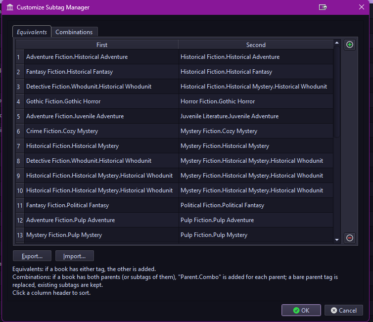
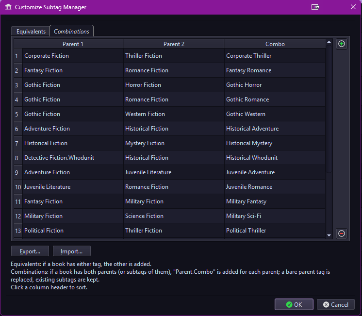

# Subtag Manager (calibre plugin)

Made with Grokbot.

Applies two kinds of tag rules — **Equivalents** and **Combinations** — to every book in the
current calibre library. It scans first without writing anything, shows a per-book preview, and
writes only after you click **Apply changes**.

## Back up first
This plugin bulk-edits tags. Before the first real run, back up your library. You can copy the
whole library folder while calibre is closed, or use *Library → Library maintenance → Back up
metadata* plus a copy of `metadata.db`. Try your rules on a copy of the library first.

## Configure
Open the dialog from either place:
* the small arrow next to the **Subtag Manager** toolbar button → **Configure rules...**, or
* *Preferences → Advanced → Plugins → User interface action → Subtag Manager → Customize plugin*.

The dialog has two tabs. Each tab is an editable table with a **+** button (top right) to add a
rule and a **−** button (bottom right) to remove the selected rules. Double-click a cell to edit
it.

* **Equivalents**: columns *First* and *Second*.
* **Combinations**: columns *Parent 1*, *Parent 2*, *Combo*.

Completely blank rows are ignored. A partly filled row blocks saving until you complete it or
remove it. Rules are stored with calibre JSONConfig in `plugins/subtag_manager.json` in the calibre
config folder.

 

### Sorting the rule tables
Click a column header (*First*, *Second*, *Parent 1*, *Parent 2*, *Combo*) to sort the rows by
that column. Click the same header again to reverse the order. An arrow in the header shows the
current sort.
* Sorting ignores case and accents, and numbers sort by value, so `Book 2` comes before
  `Book 10`. Whole rules always move together.
* Sorting happens once per click. It does not re-sort while you type, so rows never jump around
  while you edit them. A row added with **+** appears at the bottom with its first cell open for
  editing, even when the table is sorted. Adding or editing a row hides the arrow because the
  table may no longer be in order. Click a header to sort again.
* **−** removes exactly the selected rows, whatever the current sort.
* Clicking OK saves exactly the rules shown, in the order they are displayed. Rule order has
  **no effect** on the result, so sorting is only for convenience.

### Export and import rules
* **Export...** saves the rules from **both** tabs to a JSON file you choose. It uses what the
  dialog currently shows, including edits you have not saved yet. If some rows are incomplete,
  you are warned and they are left out of the file. The file is UTF-8 JSON with a version number:
  ```json
  {
    "format": "calibre-subtag-manager-rules",
    "schema_version": 1,
    "equivalents":  [{"first": "Gothic Fiction.Gothic Horror", "second": "Horror Fiction.Gothic Horror"}],
    "combinations": [{"parent1": "Romance Fiction", "parent2": "Western Fiction", "combo": "Western Romance"}]
  }
  ```
  Non-English text, such as accents or Japanese, is written as normal UTF-8 characters.
  Files exported by the older Tag Manager plugin (`"format": "calibre-tag-manager-rules"`) can
  still be imported.
* **Import...** reads such a file. Rows can also be written as lists, such as `["a", "b"]`.
  * The whole file is checked first. If any row is empty, partial, has unknown fields, or the file
    is not a Subtag Manager (or older Tag Manager) file, has a newer version, or is not valid
    JSON or UTF-8, **nothing** is imported. An error message lists every problem with its row
    number.
  * You then choose **Replace** (swap in the file's rules), **Merge** (add the file's rules to the
    ones shown and skip duplicates), or **Cancel**.
  * Duplicate checks ignore case and spaces around `.`. For Equivalents and for the two parents of
    a Combination, the order of the two tags does not matter: `A ⇄ B` is the same rule as `B ⇄ A`.
  * Importing only changes what the dialog shows. Nothing is saved until you click **OK**, and
    **Cancel** discards the import.
* CSV export is not included; JSON is the only file format.

## Run
Click the **Subtag Manager** toolbar button, or use the arrow → **Apply rules to library...**.
1. The plugin reads the tags of every book in the library. Nothing is written at this stage.
2. If any book would change, a confirmation window lists **each affected book** with its ID,
   title, current tags, tags to add, tags to remove, and resulting tags. It also shows a count of
   affected and scanned books and the total additions and removals. Click any column header to
   sort the list: ID sorts by number, and the other columns ignore case. Sorting only changes the
   display, not which books are written. Books where the rules did not
   converge are listed as skipped.
3. **Cancel** is the default button. Cancel, Esc, or closing the window writes nothing. Only
   **Apply changes to N book(s)** writes.
4. The plugin then checks that the same library is still open. If you switched libraries,
   nothing is written. Any book whose tags changed after the scan, or that was deleted, is
   skipped and reported. All remaining updates are saved in one batched `new_api.set_field('tags', …)`
   call with `allow_case_change=False`, so the spelling of existing tags elsewhere in the library is
   not changed. The book list and Tag browser then refresh.

## Rule semantics
* Tags are compared **case-insensitively**, the same way calibre does, and spaces around `.` are
  ignored. New tags use the spelling from your rule.
* **Equivalents** (First ⇄ Second). If a book has either tag exactly, the other tag is added if it
  is missing. The rule works in both directions, and chains are followed: A⇄B plus B⇄C gives a book
  with any one of them all three. Only exact tags trigger it: `Gothic Fiction.Gothic Horror.X` does
  not trigger a rule for `Gothic Fiction.Gothic Horror`.
  Example: `Gothic Fiction.Gothic Horror` ⇄ `Horror Fiction.Gothic Horror`.
* **Combinations** (Parent 1 + Parent 2 → Combo). The rule applies when the book has a tag
  matching Parent 1 **and** a tag matching Parent 2. A tag matches a parent if it *is* the parent
  or is a subtag of it, split at a dot. `Romance Fiction.Erotic Romance` matches `Romance Fiction`.
  `Romance Fiction` does **not** match `Romance Fiction.Erotic Romance`, and `Romance Fictionalized`
  does not match `Romance Fiction`.
  When the rule applies, `Parent.Combo` is added for **both** parents:
  * If the bare parent tag is on the book, it is **replaced** by `Parent.Combo`.
  * Existing subtags of the parent are **kept**, and `Parent.Combo` is added separately.
  * Example: `Romance Fiction` + `Western Fiction` → `Western Romance` turns
    `Romance Fiction, Western Fiction` into
    `Romance Fiction.Western Romance, Western Fiction.Western Romance`.
  * Example: parent `Fantasy Fiction`, combo `Political Fantasy`. A book tagged
    `Fantasy Fiction.High Fantasy` keeps that tag and also gets `Fantasy Fiction.Political Fantasy`.
    A book tagged plain `Fantasy Fiction` has it replaced by `Fantasy Fiction.Political Fantasy`.
* **Order and termination.** Each pass does the following:
  1. Apply the equivalence closure.
  2. Check **all** combination rules against the same snapshot of tags.
  3. Add all combo tags.
  4. Remove the bare parents that were replaced.

  Because removals happen last, one rule removing `Romance Fiction` never stops another rule
  that also uses `Romance Fiction` from applying. Passes repeat until the tags stop changing, so
  combo outputs can feed equivalents and other combos. The process terminates because a bare tag
  is removed only after a more specific tag that matches everything it matched has been added. As
  a safeguard, there is also a limit of 50 passes plus detection of repeated states. A book that
  hits either limit is left unchanged and reported.
* **Idempotent.** Running the plugin again right away proposes no changes.
* A bare parent removed by a combination counts as satisfied by its more specific form, even if
  an equivalence would add it back. It does not reappear.

## Development
```
python3 -m unittest discover -s tests -p 'test_*.py' -v   # engine, write gate, natural sort, import/export (no calibre needed)
python3 build.py /workspace/Subtag_Manager.zip            # syntax check and build the ZIP
# optional, using a throwaway config dir and library only:
CALIBRE_CONFIG_DIRECTORY=/tmp/tm-cfg calibre-customize -a /workspace/Subtag_Manager.zip
CALIBRE_CONFIG_DIRECTORY=/tmp/tm-cfg QT_QPA_PLATFORM=offscreen calibre-debug tests/calibre_runtime_test.py -- /path/to/throwaway-library
CALIBRE_CONFIG_DIRECTORY=/tmp/tm-cfg QT_QPA_PLATFORM=offscreen calibre-debug tests/calibre_ui_test.py   # sorting, add/remove while sorted, save, export/import, preview sort
```
